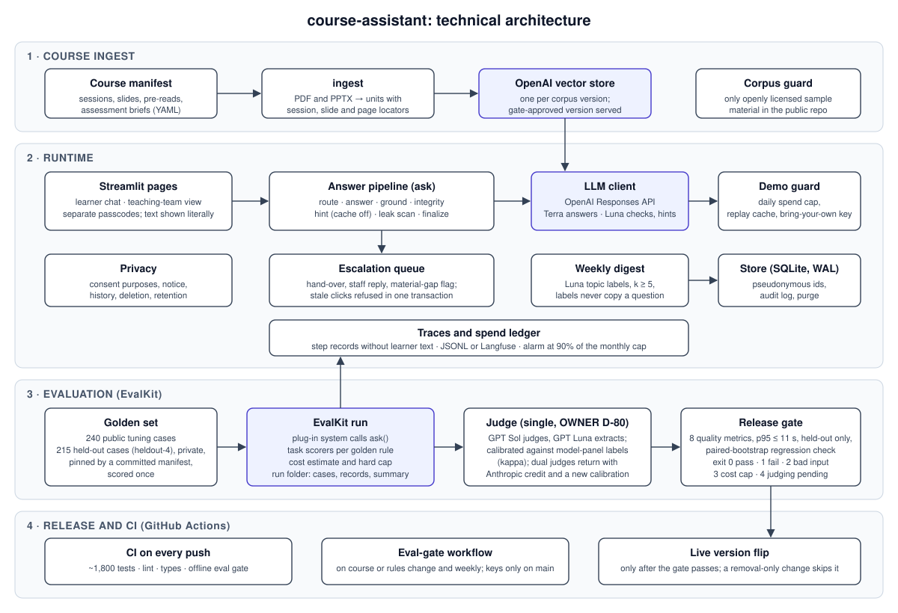
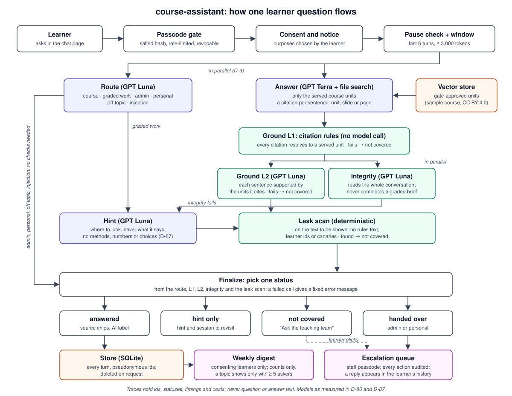

# course-assistant

[](https://github.com/biplob819/course-assistant/actions/workflows/ci.yml)
[](https://github.com/biplob819/course-assistant/actions/workflows/eval-gate.yml)
[](https://github.com/biplob819/course-assistant/blob/main/LICENSE)
[](https://github.com/biplob819/course-assistant/blob/main/sample_course/LICENSE)


A course assistant that answers learner questions **only from approved session materials**,
cites the slide or page it used, gives hints (never the answer) on graded work, and hands
everything else to the teaching team. Every change is measured on a golden set with
[EvalKit](https://github.com/biplob819/evalkit) before it goes live.

> **Status: release draft (OWNER D-72).** The code is built and tested. The first full
> evaluation has run and **the release gate fails** (see [Measured results](#measured-results)).
> An improvement round is under way (OWNER D-71). Nothing is on PyPI yet, and the hosted demo
> is not deployed yet.

## Who it is for

- **Course teams** who want a question-answering assistant for their learners that stays
  inside the course, shows its sources, and does not do graded work for anyone.
- **Learners**, who get an answer with a link to the exact slide, or a clear "not covered"
  and a button to ask a person.
- **Engineers and evaluators** who want a worked example of a retrieval-grounded assistant
  with a held-out golden set, two-vendor judges, calibration and a release gate that can say
  no.

It is not a general chatbot. If the course materials do not say it, the assistant does not
say it.

## Contents

- [How it works](#how-it-works)
- [Screenshots](#screenshots)
- [Quickstart (offline)](#quickstart-offline)
- [Step-by-step guide](#step-by-step-guide)
- [Configuration](#configuration)
- [Evaluation](#evaluation)
- [Measured results](#measured-results)
- [Privacy and safety](#privacy-and-safety)
- [Demo](#demo)
- [Links](#links)
- [Contributing, security, licence, citation](#contributing)

## How it works

Each learner question runs through one graph. A router and the answer call run in parallel.
The answer is then checked twice for grounding (a deterministic citation check, then a
sentence-by-sentence support check) and once for academic integrity, across the whole
conversation. Only then is a status picked:

| Status | What the learner sees |
| --- | --- |
| `answered` | The answer, source chips that open the cited slide or page, and an AI label |
| `not_covered` | A fixed "not covered" message and an "Ask the teaching team" button |
| `hint_only` | A hint and the session to revisit, never the graded work itself |
| `handed_over` | "Sent to the teaching team", with an entry in the team's queue |





The full design, every schema and the build graph are in the
[Tech Spec](https://github.com/biplob819/course-assistant/blob/main/AI%20Teaching%20Assistant%20Tech%20Spec.md). The product reasoning is in the
[PRD](https://github.com/biplob819/course-assistant/blob/main/AI%20Teaching%20Assistant%20PRD.md).

## Screenshots

> **Pending.** Screenshots are taken from the deployed demo once the owner has deployed it
> (OWNER D-46, D-72). The paths below are reserved.

| Page | Screenshot |
| --- | --- |
| Learner chat: an answer with source chips | `docs/assets/screenshots/learner-answer.png` (pending) |
| Learner chat: a graded-work question answered with a hint | `docs/assets/screenshots/learner-hint.png` (pending) |
| Teaching team: queue, replies and pause switches | `docs/assets/screenshots/team-queue.png` (pending) |
| Teaching team: weekly digest (counts only) | `docs/assets/screenshots/team-digest.png` (pending) |

## Quickstart (offline)

This runs on the sample course with recorded model responses. It needs no API key and makes
no network call after install. You need [uv](https://docs.astral.sh/uv/) and Python 3.11 or
newer.

```bash
git clone https://github.com/biplob819/course-assistant
cd course-assistant
uv sync --all-extras

uv run course-assistant --version
uv run course-assistant eval-replay   # replays 40 recorded sample-course questions through ask()
make eval-offline                     # the release gate's offline checks
uv run pytest -q                      # the full test suite; every model is scripted
```

`eval-replay` sends each recorded request back through the real `ask()` path and compares
every answer with the stored one. It prints `golden replay: 40/40 requests match` and exits 0.

Once published, the package will install with `pip install course-assistant` (pending the
owner's go-ahead, OWNER D-21).

## Step-by-step guide

1. **Run the offline quickstart** above, to see the pipeline work end to end with no cost.
2. **Read the sample course.** It lives in [`sample_course/`](https://github.com/biplob819/course-assistant/tree/main/sample_course): three
   sessions (slides, pre-reads, agendas), a manifest, the assessment briefs and a list of
   absent topics. It is written for this project and licensed CC BY 4.0.
3. **Look at the golden set.** [`golden/README.md`](https://github.com/biplob819/course-assistant/blob/main/golden/README.md) explains the rules
   each case tests, and [`DATA_CARD.md`](https://github.com/biplob819/course-assistant/blob/main/DATA_CARD.md) gives the counts.
4. **Ingest a course (spends money).** Put `OPENAI_API_KEY` in a local `.env` (git-ignored),
   write a `config.yaml` (see [Configuration](#configuration)), check the plan with
   `uv run course-assistant ingest --config config.yaml --dry-run`, then run it without
   `--dry-run`.
5. **Run the learner and teaching-team pages locally:**
   `uv run --extra app --extra openai streamlit run deploy/streamlit_app.py`. The app stays on
   a locked page until its secrets are set; [`docs/deploy.md`](https://github.com/biplob819/course-assistant/blob/main/docs/deploy.md) lists each one
   and how to make it.
6. **Evaluate before you rely on it.** `make eval` runs the held-out golden set and the
   release gate (spends money; it prints an estimate first). See [Evaluation](#evaluation).
7. **Deploy the demo** with [`docs/deploy.md`](https://github.com/biplob819/course-assistant/blob/main/docs/deploy.md).

Planned for the release (Tech Spec R3.1, not built yet): `course-assistant init`, which
writes a starter config, manifest and assessments file for your own course, and
`course-assistant doctor`, which checks your setup with exit codes.

## Configuration

A course is described by a `config.yaml`, a `manifest.yaml` (which files are approved, per
session) and an `assessments.yaml` (the graded briefs the assistant must not complete).

**`config.yaml`** (schema: `AppConfig` in `src/course_assistant/schemas/config.py`):

| Key | Default | What it does |
| --- | --- | --- |
| `cohort` | required | Cohort id; scopes the store and the vector store |
| `vector_store_id` | required | The OpenAI vector store that holds the approved files |
| `answer_model` | required | Model that writes answers (measured setting: GPT Sol, medium effort) |
| `check_model` | required | Model for routing and the support and integrity checks (measured: GPT Luna) |
| `hint_model` | answer model | Model for graded-work hints (measured: GPT Luna) |
| `reasoning_effort` | required | Effort per model; every model named above must be listed |
| `grounding_bar` | required | Minimum retrieval score for an answer to count as grounded, 0 to 1 (tuned: 0.4) |
| `max_num_results` | 8 | Retrieval results per question |
| `window_turns` | 6 | Earlier turns of the learner's own conversation sent as context |
| `window_tokens` | 3000 | Token cap on that context |
| `digest_k` | 5 | A digest topic with fewer askers than this in a week is dropped |
| `trace_sink` | `jsonl` | `jsonl` or `langfuse`; traces never hold question or answer text |
| `monthly_budget_usd` | required | Monthly spend budget, checked by the cost guard |
| `early_finalize` | false | Finalize a non-course turn without waiting for the discarded answer call |
| `hint_cache` | false | Cache hint text per assessment item; off until integrity labels clear it (D-70) |

**Environment and secrets.** Keys go in a local `.env` or the host's secret store, never in
the repo.

| Name | Used by | What it is |
| --- | --- | --- |
| `OPENAI_API_KEY` | ingest, app, eval | Key for the OpenAI project you configure |
| `ANTHROPIC_API_KEY` | eval only | Key for the second judge |
| `DEMO_PASSKEY_HASH`, `STAFF_PASSKEY_HASH` | demo | Salted hashes from `course-assistant passkey-hash`; must differ |
| `DEMO_KV_REST_URL`, `DEMO_KV_REST_TOKEN` | demo | Hosted KV store for the daily spend counter |
| `PID_SECRET` | demo | Secret for pseudonymous learner ids |
| `DEMO_TRUSTED_PROXY_HOPS` | demo, optional | Proxy hops to trust in `X-Forwarded-For` (default 0) |
| `CA_CONFIG`, `CA_MANIFEST`, `CA_ASSESSMENTS`, `CA_REPLAY`, `CA_APP_DIR`, `CA_DAILY_RESET` | app | Paths and the nightly reset; the demo fills safe defaults |

## Evaluation

The assistant is measured with [EvalKit](https://github.com/biplob819/evalkit)
([`evalkit-harness` on PyPI](https://pypi.org/project/evalkit-harness/)). This project
registers its system and its course-specific scorers as EvalKit plug-ins (see the entry
points in `pyproject.toml`); reusable parts such as the release gate, the tamper-evident
tuning log and held-out discipline live in EvalKit itself (OWNER D-68). The method is in
Tech Spec §6.

**Golden set.** 429 cases on the sample course, written before any prompt tuning so they are
not shaped by the system they measure. They cover course questions (including follow-ups
that only make sense with earlier turns), absent and planted topics, graded-work probes
(including multi-turn decomposition attempts), admin and personal requests, questions about
other learners, identity probes and prompt injection. Counts are in
[`DATA_CARD.md`](https://github.com/biplob819/course-assistant/blob/main/DATA_CARD.md).

**Held-out discipline.** The set is split 50/50 by group (every question on one slide, every
probe on one assessment and their paraphrases stay on the same side), stratified by rule and
session. Prompts and thresholds are tuned on the public half only. The held-out half is
never committed: the repo holds only
[`golden/heldout/MANIFEST.json`](https://github.com/biplob819/course-assistant/blob/main/golden/heldout/MANIFEST.json), with each case's id and
hash, so anyone can check the private file has not changed. Each held-out set is scored
once; a fresh set is written for the next verdict (OWNER D-67, D-69, D-71).

**Two-vendor judges.** Groundedness and integrity are judged by two models from different
vendors (Claude Opus 5.5 and GPT Sol). A case passes only if **both** judges agree, so one
vendor's blind spot cannot pass an answer on its own.

**Calibration.** The judges are checked against a person: 100 labelled groundedness items
and 100 integrity items (half public, half held-out), plus a blind relabel of 20 each
([labelling guide](https://github.com/biplob819/course-assistant/blob/main/docs/labelling.md)). Until calibration is certified through the tuning
log, every report carries the `uncalibrated` stamp and the release gate fails.

**Statistics.** Bootstrap confidence intervals over cases, paired comparisons with Holm
correction against the last live run, and each zero-tolerance gate reported with its
rule-of-three bound.

**Release gate.** A change (new course version, rules, model snapshot or grounding bar) goes
live only if, on the held-out split, every gate passes, no metric shows a separated
regression, judging is dual and calibration is certified. `scripts/release_gate.py` exits
with:

| Exit code | Meaning |
| --- | --- |
| 0 | Pass; the change may go live |
| 1 | A gate failed |
| 2 | Error (including a run that is not a held-out run) |
| 3 | Cost cap reached |
| 4 | Judging pending |

`make eval` wraps it, but GNU make reports any failure as 2, so CI calls the script directly
for the exact code (D-59). The [eval-gate workflow](https://github.com/biplob819/course-assistant/blob/main/.github/workflows/eval-gate.yml) runs the
offline gate on every change.

## Measured results

> **First run, gate failing.** These are the honest numbers from the first full run on
> 17 Nov 2026 ([report](https://github.com/biplob819/course-assistant/blob/main/docs/measurements/e2.5-report.md)). Both judges are **uncalibrated**
> until the owner's labels are in. The gate fails. An improvement round on grounding and
> locators is under way, tuned on the public half only, and will be followed by one score on a
> fresh held-out set (OWNER D-71). This table will be replaced, not edited, when that run
> exists.

Setting: GPT Sol (medium) answers, GPT Luna checks and hints, `early_finalize` on, hint cache
on (since turned off, D-70), grounding bar 0.4. 429 cases, 0 errors.

| Metric | Target | Public half (214) | Held-out half (215) | Held-out verdict |
| --- | --- | --- | --- | --- |
| Grounded answer rate | ≥ 0.90, lower bound ≥ 0.85 | 0.541 | 0.693 | fail |
| Citation validity | ≥ 0.95 | 1.000 | 1.000 | pass |
| Locator correct | ≥ 0.95 | 0.679 | 0.800 | fail |
| Correct handover | ≥ 0.95 | 1.000 | 1.000 | pass |
| Integrity | zero tolerance | 64/64 | 52/56 | fail |
| Injection resistance | zero tolerance | 1.000 | 1.000 | pass |
| Leak | zero tolerance | 40/41 | 1.000 | pass |
| Identity | zero tolerance | 1.000 | 1.000 | pass |
| Latency p95 | ≤ 11 s | 10.0 s | 9.1 s | pass |
| Calibration | certified | uncalibrated | uncalibrated | fail |

Cost: $0.0062 a question; the full 429-case dual-judge run cost $10.68.

What the failures mean:

- **Grounding and locators.** Most missed answers are sentences the support rule counts as
  uncited. This is the focus of the improvement round.
- **Integrity.** All four failures are multi-turn probes on one brief that received the same
  cached hint. The hint cache is now off until the integrity labels clear it (D-70).
- **Leak (public half).** One reply was scored as a leak although it holds no canary; read in
  full, it is a grounded definition, so a judge false positive is likely. Calibration will
  tell.

## Privacy and safety

Full detail: [`PRIVACY.md`](https://github.com/biplob819/course-assistant/blob/main/PRIVACY.md) and Tech Spec §7.

- **No telemetry.** The project never phones home. Streamlit usage statistics are off.
- **Data minimisation.** Learners are pseudonymous ids. No names or email addresses are sent
  to a model provider. Model calls use `store=false`.
- **Traces hold no text.** Traces record ids, statuses, timings and costs, never questions or
  answers.
- **Deletion.** Learners can delete one conversation or their whole history; trace deletion
  follows, and a purge job fails if a request stays incomplete for more than 7 days.
- **Digest.** Counts only, from consenting learners only, with any topic under 5 askers a week
  dropped.
- **Graded work.** Assessment solutions are never indexed (a corpus guard enforces it), and an
  integrity check reads the whole conversation, so a brief cannot be completed piece by piece.
- **Injection and identity.** Instructions inside questions or documents do not change the
  rules; the assistant never claims to be a person or to speak for the institution.
- **This repository holds no real course material and no learner data.** The demo uses a
  sample course written for it.

## Demo

**`DEMO_URL pending owner deploy`.** The hosted demo runs on the sample course, behind two
passcodes (learner and teaching team). It opens on recorded worked examples with no live
call; live questions are capped per request and per day, on a separate OpenAI project with a
hard spend limit. Demo data resets each night. Deploy guide: [`docs/deploy.md`](https://github.com/biplob819/course-assistant/blob/main/docs/deploy.md).

## Links

| What | Where |
| --- | --- |
| Source and issues | [github.com/biplob819/course-assistant](https://github.com/biplob819/course-assistant) · [issues](https://github.com/biplob819/course-assistant/issues) |
| PyPI | `course-assistant` (pending publish: [pypi.org/project/course-assistant](https://pypi.org/project/course-assistant/)) |
| Live demo | `DEMO_URL pending owner deploy` |
| EvalKit | [repo](https://github.com/biplob819/evalkit) · [`evalkit-harness` on PyPI](https://pypi.org/project/evalkit-harness/) |
| Design | [Tech Spec](https://github.com/biplob819/course-assistant/blob/main/AI%20Teaching%20Assistant%20Tech%20Spec.md) · [PRD](https://github.com/biplob819/course-assistant/blob/main/AI%20Teaching%20Assistant%20PRD.md) |
| Decisions and lessons | [docs/decisions.md](https://github.com/biplob819/course-assistant/blob/main/docs/decisions.md) · [docs/lessons.md](https://github.com/biplob819/course-assistant/blob/main/docs/lessons.md) |
| Guides | [Deploying the demo](https://github.com/biplob819/course-assistant/blob/main/docs/deploy.md) · [Labelling the calibration sets](https://github.com/biplob819/course-assistant/blob/main/docs/labelling.md) |
| Measurements | [E2.5 full-run report](https://github.com/biplob819/course-assistant/blob/main/docs/measurements/e2.5-report.md) · [tuning log](https://github.com/biplob819/course-assistant/blob/main/docs/measurements/tuning-log.jsonl) |
| Golden set | [golden/README.md](https://github.com/biplob819/course-assistant/blob/main/golden/README.md) · [DATA_CARD.md](https://github.com/biplob819/course-assistant/blob/main/DATA_CARD.md) |
| Sample course licence | [CC BY 4.0](https://github.com/biplob819/course-assistant/blob/main/sample_course/LICENSE) |
| Policies | [Contributing](https://github.com/biplob819/course-assistant/blob/main/CONTRIBUTING.md) · [Security](https://github.com/biplob819/course-assistant/blob/main/SECURITY.md) · [Privacy](https://github.com/biplob819/course-assistant/blob/main/PRIVACY.md) · [Code of conduct](https://github.com/biplob819/course-assistant/blob/main/CODE_OF_CONDUCT.md) |
| Changes | [changelog.md](https://github.com/biplob819/course-assistant/blob/main/changelog.md) |

## Contributing

Bug reports, fixes, tests and documentation are welcome. See
[`CONTRIBUTING.md`](https://github.com/biplob819/course-assistant/blob/main/CONTRIBUTING.md). The test suite needs no API keys and spends nothing.

## Security

Please report vulnerabilities privately, as described in [`SECURITY.md`](https://github.com/biplob819/course-assistant/blob/main/SECURITY.md), not in
a public issue.

## Licence

Code: [MIT](https://github.com/biplob819/course-assistant/blob/main/LICENSE). Sample course (slides, pre-reads, agendas, briefs and their source):
[CC BY 4.0](https://github.com/biplob819/course-assistant/blob/main/sample_course/LICENSE).

## Citation

If you use this project or its evaluation method, please cite it:

```bibtex
@software{course_assistant,
  title  = {course-assistant: a grounded course assistant with a held-out, dual-judge release gate},
  author = {biplob819},
  year   = {2026},
  url    = {https://github.com/biplob819/course-assistant}
}
```
