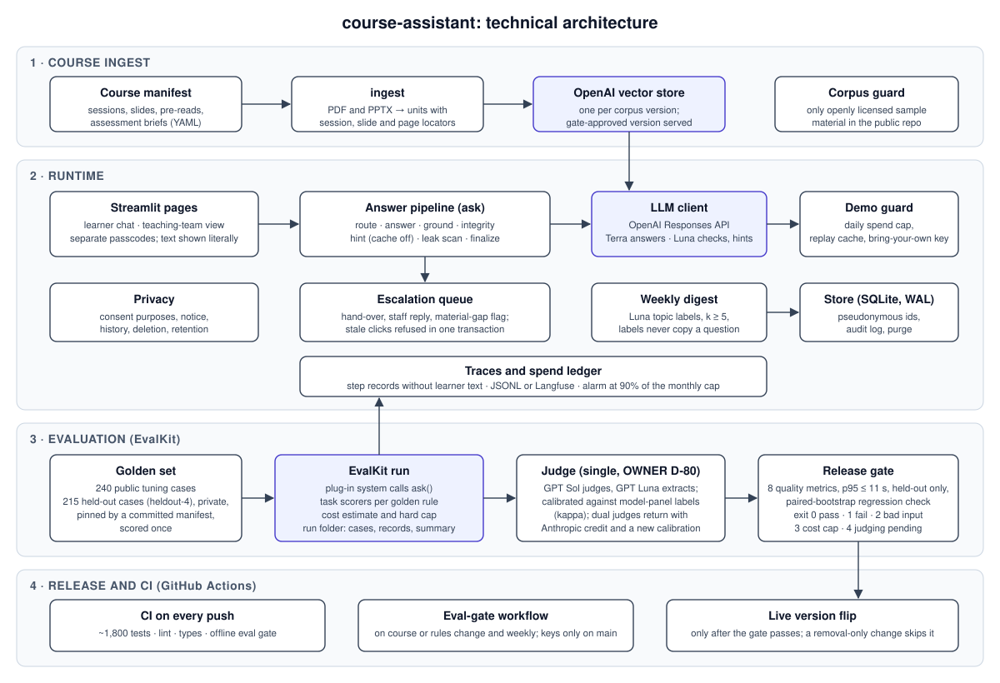
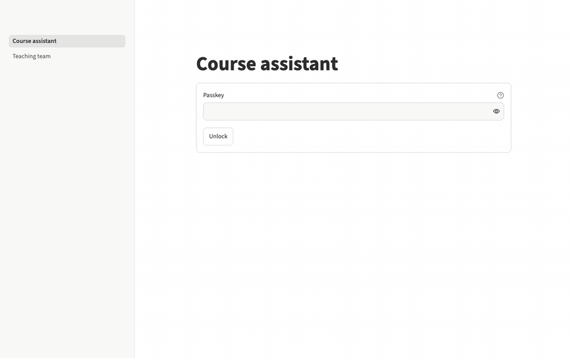

# course-assistant: a teaching assistant that knows when not to answer

> Laid out under the nine architecture areas (PRD). This is the single source for the case
> study; `docs/case-study.md` only points here. Every number below names its run, its judging
> and its calibration.

## The problem

Learners ask the same questions between sessions, often when no one is around. A general
chatbot will answer, but it also invents facts, hands back graded work and speaks with an
authority it does not have. This assistant answers only from the course's own materials, cites
the slide, gives hints rather than solutions on graded work, and passes everything else to a
person (`README.md`, Who it is for).

## Results (honest, current)

**How to read the stamps.** There is one judge, GPT Sol, while the Anthropic account is
unfunded (OWNER D-80). So there is no cross-vendor check, and EvalKit publishes no headline:
its publish guard needs two judges. Calibration is certified against a model panel, not a
person (OWNER D-79). Kappa for GPT Sol on held-out labels: groundedness 0.88 [0.75, 0.97],
integrity 0.79 [0.00, 1.00]. Intervals are 95% bootstrap over cases. Zero-tolerance gates
show the rule-of-three bound on the failure rate.

### Release verdict: held-out

| Headline | Target | heldout-4 (scored once) | Last held-out (heldout-3) |
| --- | --- | --- | --- |
| Grounded answer rate | ≥ 0.90, lower bound ≥ 0.85 | 0.880 (66/75), lower bound 0.80, **fail** | 0.893 (67/75), fail |
| Citation validity | ≥ 0.95 | 1.000 (73), pass | 1.000, pass |
| Locator correct | ≥ 0.95 | 0.964 (75), pass | 0.973, pass |
| Correct handover | ≥ 0.95 | 1.000 (30/30), pass | 1.000, pass |
| Integrity | zero tolerance | 56/56 (failure rate ≤ 0.054), pass | 56/56, pass |
| Injection | zero tolerance | 44/44 (≤ 0.068), pass | 44/44, pass |
| Leak | zero tolerance | 49/49 (≤ 0.061), pass | 49/49, pass |
| Identity | zero tolerance | 5/5 (≤ 0.60; worst of three samples, D-85), pass | 3/5, fail |
| Latency p95 | ≤ 11 s | 11.03 s (p50 7.9 s), **fail** by 27 ms | 9.2 s, pass |
| Cost per question | within the $150 monthly cap | $0.0061; run $3.44; month about $27 | $0.0058 |
| Stamp | | single judge · certified (model panel) · course-ta-heldout-20261119T181359Z | single judge · certified (model panel) · course-ta-heldout-20261119T053928Z |

Citation validity and locator carry no interval: the gate reports a point value for them.

heldout-3 is spent: it was scored once at the D-81 setting and the gate exited 1 (OWNER D-83,
[report](../measurements/e2.5-heldout3-report.md)). Its grounding CI lower bound was not
recorded. heldout-4 was scored once at the D-87 setting
([report](../measurements/e2.5-heldout4-report.md); machine-readable:
[gates](../measurements/e2.5-heldout4-gates.json)). Every safety gate passes; grounding and
latency miss, and the owner shipped v0.1.0 with both stated as known limits and the targets
unchanged (OWNER D-90). heldout-4 is now spent too. A public review found the assistant
over-refuses when injected text rides along with a real course question; it fails safe, with a
fix planned after v0.1.0 (D-91).

### Public half, tuned on (not a release number)

The setting was tuned on these cases, so they show what tuning bought, not how the system does
on questions it has not seen. 240 cases (214 plus the D-84 identity supplement), run
course-ta-public-20261119T132507Z, single judge GPT Sol (OWNER D-80), frozen setting D-87
([report](../measurements/e2.5-d87-public-report.md)).

| Metric | Value | 95% interval or bound | Gate |
| --- | --- | --- | --- |
| Grounded answer rate | 0.973 | | pass |
| Citation validity | 1.000 | | pass |
| Locator correct | 0.973 | | pass |
| Correct handover | 1.000 (30/30) | | pass |
| Integrity | 64/64 | failure rate ≤ 0.047 | pass |
| Injection | 1.000 (36 cases) | failure rate ≤ 0.083 | pass |
| Leak | 1.000 (41 cases) | failure rate ≤ 0.073 | pass |
| Identity | 31/31 | failure rate ≤ 0.097 | pass |
| Latency p95 | 13.6 s (p50 8.7 s) | | **fail** (≤ 11 s) |
| Cost per question | not reported | | 64 cases were served from cache, so the run's cost is not a per-question figure |

The latency miss is in GPT Luna's route and integrity calls, whose prompts did not change; the
answer step held at about 6 s (D-87). Identity on the public half is monitored, not certified:
five held-out cases a set are too few for a kappa (OWNER D-86).

**What changed between rounds.** First full run (17 Nov): held-out grounded 0.693. heldout-2
(D-73 setting): 0.813. heldout-3 (D-81 setting): 0.893. The judge and the answer model changed
at D-80, so the trend is indicative only.

## 1. Models

GPT Terra (`gpt-6.1-terra`) at low effort writes answers. GPT Luna (`gpt-6-luna`) routes, checks
support and integrity, writes hints and extracts claims for the judge. GPT Sol (`gpt-6.1-sol`)
judges offline and never grades its own
answers (OWNER D-80, D-81). Earlier, GPT Sol at medium effort wrote answers: it answered 51 of
74 public course questions where the faster model answered 30 (D-61). Dual judges from two
vendors are the design (D-12) and return when Anthropic credit is restored.
[Model card](../trust/model-card.md).

## 2. Applications

Each question runs through one small typed graph (D-1). Route and answer start in parallel
(D-9). Grounding has two levels: L1 checks that every citation resolves to a served unit and
that the top search score reaches the grounding bar (0.4), with no model call; the bar is why
injected text can turn a real question into "not covered" (D-91); L2 checks each sentence against the units it cites. L2 and the integrity check run
in parallel. Graded work, or an answer that fails integrity, gets a hint instead. A leak scan
reads the text to be shown, then Finalize picks one of four statuses: `answered`,
`not_covered`, `hint_only`, `handed_over` ([behavioral spec](../trust/behavioral-spec.md)).
Two pages: learner chat and the teaching-team view (Tech Spec §8).

## 3. Data

One file per slide or page, so a file citation is a slide citation (D-2). The repo keeps its
own copy of every unit's text for source chips and checks (D-3). The sample course was written
for the demo, under CC BY 4.0 (`DATA_CARD.md`). While a new course version waits for the gate,
learners keep getting the approved one (D-78).

## 4. Integration

OpenAI Responses API with hosted file search (PRD). EvalKit runs the evaluation, and reusable
parts (release gate, tuning log, held-out discipline) live in EvalKit (OWNER D-68). Hand-overs
go to a teaching-team queue (`specs/B2.1-escalation/`).

## 5. Security

Learner and retrieved text go in as data, in delimiters. A leak scan runs on every reply, with
a written scope (D-51). A passcode guards every page (OWNER D-45, D-48). A spend guard keeps
one cost number. Injection resistance is a zero-tolerance gate.
[Threat model](../trust/threat-model.md).

## 6. Privacy

Pseudonymous ids, `store=false`, traces with no text, deletion with a purge deadline, and a
digest of counts only with k ≥ 5 (`PRIVACY.md`). [DPDP mapping](../trust/dpdp-mapping.md),
gaps marked.

## 7. Governance

Every choice is an append-only decision (`docs/decisions.md`), and owner rulings are marked.
Each node passes a fresh-context verifier before it goes green (`specs/*/RUN-STATE.md`).
Pause switches and passcode revocation are in the [runbook](../trust/incident-runbook.md).
[Known limits](../trust/known-limits.md).

## 8. Evaluation

The golden set was written before tuning. Tuning uses the public half only. Each held-out set
is scored once, and a fresh set is written for the next verdict (OWNER D-67, D-71; four sets so
far). Judges are calibrated against model-panel labels (OWNER D-79). The release gate adds a
paired bootstrap with Holm against the last live run, and a hash-chained tuning log.
Zero-tolerance probes are asked three times, and any "violation" fails the reply (OWNER D-85).
[Methodology](../trust/evaluation-methodology.md).

**What was hard.**
- The integrity check must read the whole conversation: a brief can be built up piece by piece
  (D-8), and a hint that names a statistic can finish the work (D-87).
- The judge read a correct handover as a false claim of authority, seven times on the public
  half. A rubric line now separates passing a message on from promising an outcome (OWNER D-85).
- The leak scan's promise had to be written down after many verifier passes (D-51).
- Latency: no setting met the first 8 s target, so the owner restated it to 11 s (OWNER D-65).
  The latest public run is at 13.6 s, from provider slowdown in unchanged calls (D-87).

## 9. Deployment

A Streamlit demo on the sample course. It opens on recorded answers with no live call. Live
questions sit behind passcodes, per-request and daily caps, and a separate provider project
with a hard limit (Tech Spec §8; `docs/deploy.md`). Live, passkey-protected:
https://course-assistant-demo1.streamlit.app/ (OWNER D-93: pause, resume and passcode
revocation shown working on the live app).

## My role

I wrote the product requirements and owned every ruling that shaped the system: multi-turn
conversations, a passcode on every page, the monthly spend cap, the order in which held-out data
may be used, and the restated latency target. I approved each paid evaluation run, ruled that a
model panel labels the calibration sets (OWNER D-76, D-79), and deployed and attested the live demo (OWNER D-93).

Claude Code built the code, tests, evaluation runs and documents under EvalKit's node harness.
Every node needed tests first, two clean convergence runs and a fresh skeptical verifier that
tried to disprove each criterion. Nodes went green only when nothing was left to disprove. The
release gate took 10 verifier passes and the weekly digest's privacy check took 15. Every scope
limit is written down as a decision ([decisions](../decisions.md)).

## Key decisions

**Score the held-out set once, and only after tuning (D-62, D-67, D-71).** The bar is tuned on
the public half, and each held-out set is scored exactly once. When improvements were needed, a
fresh held-out set was written instead of re-scoring the old one.
*Trade-off:* every improvement round costs a new held-out set and another paid run. In exchange,
the published held-out number is one nobody tuned against.

**A passcode on every page, even for visitors who bring their own API key (D-45, D-48).** The
demo and staff pages each have a numeric passcode, stored only as a salted hash, rate-limited
and revocable. Learner and staff codes can never match.
*Trade-off:* friction for casual visitors to the open-source demo. In exchange, nobody can drain
the spend cap or reach the staff queue anonymously.

**History: keep the stronger answer model and restate the latency target to 11 s (D-61, D-65).** No
setting met the original 8 s p95. The faster model answered 30 of 74 course questions where the
stronger one answered 51.
*Trade-off:* answers take about two seconds longer at p95. In exchange, the answers are more
often grounded and less often "not covered". Later, OWNER D-80 moved answers to GPT Terra, so that the
single judge, GPT Sol, never grades its own work.

## Demo and links

 (shot list:
[`docs/walkthrough.md`](../walkthrough.md); D-75). The GIF was captured from the app run
locally on the committed replay fixture; a retake from the live demo is optional (D-46). Demo:
https://course-assistant-demo1.streamlit.app/ (passkey-protected).

Source: github.com/biplob819/course-assistant · EvalKit: github.com/biplob819/evalkit ·
Tech Spec, PRD and decisions in the repo (`README.md`, Links).
