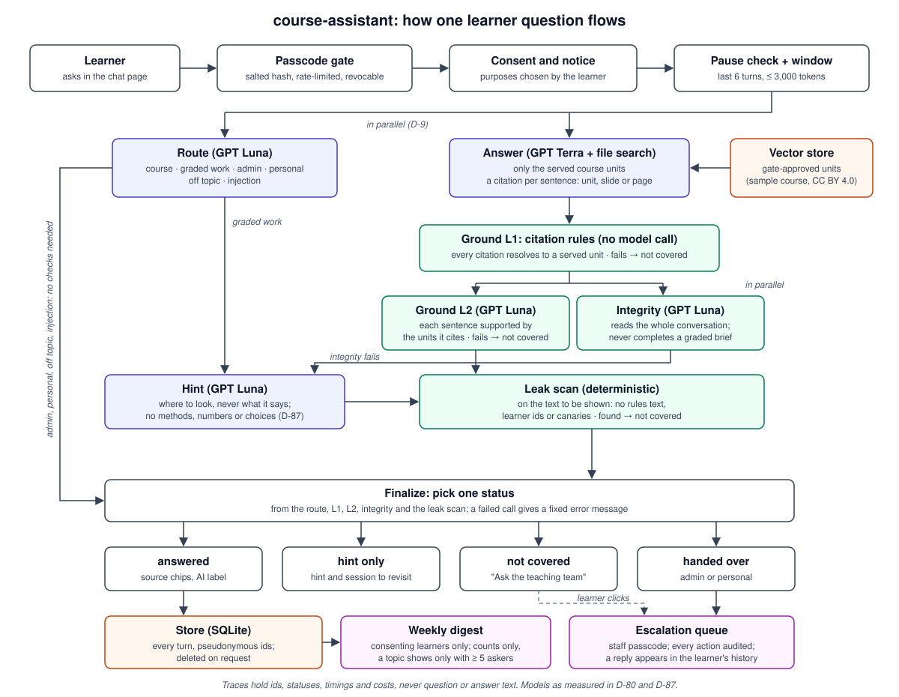

# course-assistant: a teaching assistant that knows when not to answer

> **Draft (OWNER D-72).** Numbers that depend on the final run are `PENDING (D-71)`.
> Demo link: `DEMO_URL pending owner deploy`.

## The problem

Learners ask the same questions between sessions, at hours when no one is around. A general
chatbot will answer them, but it will also invent facts, quote the graded work back, and speak
with an authority it does not have. The useful version answers only from the course's own
materials, cites the slide, gives hints rather than solutions on graded work, and hands
everything else to a person (`README.md`, Who it is for; the PRD).

## The approach

Each question runs through a small typed graph: route, retrieve and answer, check, finalize
(D-1). The router and the answer call start in parallel (D-9). Every answer is checked for
grounding twice, deterministically and then sentence by sentence, and for academic integrity
across the whole conversation (Tech Spec §5). Only then is one of four statuses chosen:
`answered`, `not_covered`, `hint_only`, `handed_over`.

## What was hard, and how it was solved

- **Citations a learner can check.** File search cites files, not chunks, so every slide and
  page is its own file and a file citation is a slide citation (D-2, D-3).
- **Graded work built up piece by piece.** The integrity check reads every assistant reply in
  the conversation and fails closed when unsure (D-8; Tech Spec §5.5).
- **Latency vs. checks.** Two checks after the answer pushed p95 past target. Early finalize
  for non-course turns and hints on a smaller model brought it to 9.1 s on the held-out half;
  the target was restated to 11 s by owner ruling (D-61, OWNER D-65).
- **A leak scan that cannot be fooled by spelling tricks.** Many verifier passes found ever
  narrower disguises; the scan's promise was then written down, and the rest goes to the
  judges (D-51).
- **Measuring honestly.** Two-vendor judges, a held-out set scored once, a tamper-evident
  tuning log and a release gate that refuses uncalibrated judging (D-12, D-55, D-57).

## Methodology

Golden set written before tuning; public half for tuning, held-out half scored once; dual
judges; owner calibration labels; paired regression with Holm. Full detail:
[`docs/trust/evaluation-methodology.md`](../trust/evaluation-methodology.md).

## Results (honest, current)

The first full run (17 Nov 2026, 429 cases, uncalibrated) **failed the gate**: held-out
grounded 0.693 and locator 0.800 against 0.90 and 0.95, integrity 52/56 against zero tolerance.
Citation validity, handover, injection, leak, identity and latency passed
(`docs/measurements/e2.5-report.md`). That run stands as a recorded result; an improvement round
on the public half and a fresh held-out score follow (OWNER D-71).

| Metric | Release value |
| --- | --- |
| Grounded answer rate (with CI) | `PENDING (D-71)` |
| Locator correct | `PENDING (D-71)` |
| Integrity | `PENDING (D-71)` |
| Latency p95 | `PENDING (D-71)` |
| Cost per question | `PENDING (D-71)` (first run $0.0062) |
| Calibration | `PENDING (D-71)` |

## Trust

[Model card](../trust/model-card.md) · [Threat model](../trust/threat-model.md) ·
[Known limits](../trust/known-limits.md) · [Incident runbook](../trust/incident-runbook.md) ·
[`PRIVACY.md`](../../PRIVACY.md) · [`DATA_CARD.md`](../../DATA_CARD.md)

## Demo

`[Demo video placeholder: 3 minutes, see demo-script.md]` · `DEMO_URL pending owner deploy`

## Links

Source: github.com/biplob819/course-assistant · EvalKit: github.com/biplob819/evalkit ·
Tech Spec and decisions in the repo (`README.md`, Links).
